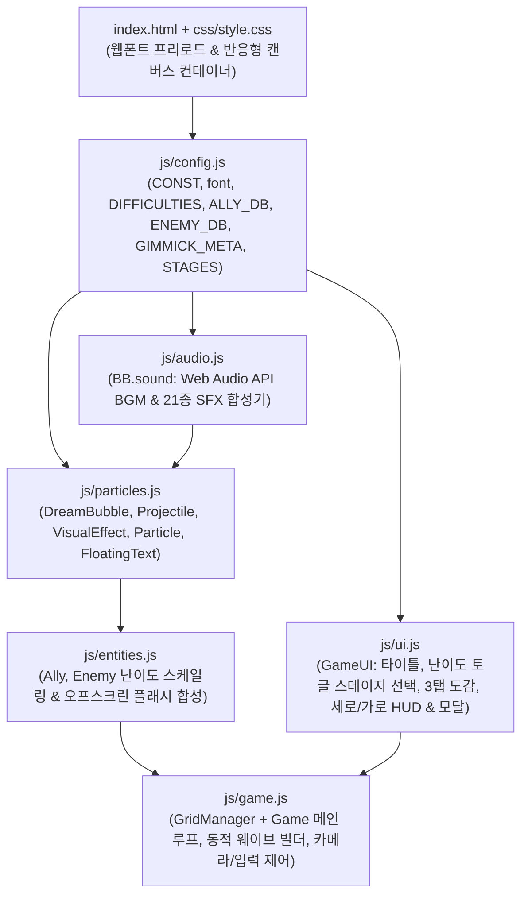

# 🎀 말랑쁘니 디펜스 (Malrang-Bbuni Defense) — 프로젝트 개발 및 유지보수 문서

> **문서 목적**: 본 문서는 **《말랑쁘니 디펜스》**의 기획 명세, 기술 스택, 소스코드 아키텍처, 핵심 구현 원리, 로컬/웹 배포 방법(GitHub Pages 포함), 그리고 차후 운영·유지보수(밸런스 패치 및 콘텐츠 확장) 절차를 통합 정리한 공식 개발 문서입니다.

---

## 목차
1. [프로젝트 개요 및 게임 정의](#1-프로젝트-개요-및-게임-정의)
2. [게임 상세 설명 및 기획 명세](#2-게임-상세-설명-및-기획-명세)
3. [개발 스택 및 시스템 아키텍처](#3-개발-스택-및-시스템-아키텍처)
4. [디렉터리 및 소스코드 구조](#4-디렉터리-및-소스코드-구조)
5. [핵심 구현 기술 상세](#5-핵심-구현-기술-상세)
6. [실행 방법 및 GitHub Pages 배포 가이드](#6-실행-방법-및-github-pages-배포-가이드)
7. [차후 운영 및 유지보수 매뉴얼](#7-차후-운영-및-유지보수-매뉴얼)

---

## 1. 프로젝트 개요 및 게임 정의

### 1.1 게임 정의 (Game Identity)
- **타이틀**: 말랑쁘니 디펜스 (*Malrang-Bbuni Defense*)
- **장르**: 캐주얼 라인 그리드 타워 디펜스 (*5×9 Lane-Grid Tower Defense*)
- **아트 & 테마 콘셉트**: 포근한 책상·문구점·태엽 공방·요술 거울·황혼 성소 플레이매트 위에서 말랑말랑한 클레이 미니어처 피규어(‘쁘니’)들이 펼치는 디오라마 전투
- **지원 플랫폼**: PC 웹 브라우저 및 모바일 웹 브라우저 (iOS Safari, Android Chrome 등 **세로/가로 양방향 반응형** 완벽 지원)
- **실행 환경 특성**: **Zero-Build / Serverless Static Web** — 별도의 빌드 도구(Webpack/Vite)나 백엔드 서버 없이 `file://` 로컬 직접 실행과 정적 웹 호스팅(GitHub Pages 등) 모두에서 100% 동일하게 동작

### 1.2 핵심 설계 지표
| 항목 | 규격 / 설정값 | 비고 |
| :--- | :--- | :--- |
| **기준 가상 해상도** | 가로 `1920 × 1080` / 세로 `1080 × 1920` | 기기 화면 비율에 따라 실시간 자동 전환 |
| **전술 그리드 규격** | `5행 × 9열` (총 45타일, 셀 크기 `136 × 128 px`) | 월드 좌표 `X: 344~1568`, `Y: 232~872` |
| **방어선 / 스폰 지점** | 좌측 방어선 `X = 318` / 우측 적 스폰 `X = 1845` | 방어선 돌파 시 라이프 차감 및 긴급 충격파 발동 |
| **캠페인 볼륨** | 총 **5단계 스테이지** × **2가지 난이도(`노말` / `어려움`)** | 스테이지별 전용 `1920×1080` 테마 배경 적용 |
| **등장 유닛 / 기믹** | 아군 **6종**, 침공 적군 **6종**, 전장 기믹 **7종** | 인게임 3탭 도감(`아군/적군/기믹`, 난이도 스탯 연동) 완비 |
| **세이브 데이터** | `localStorage` (`bb_defence_stage_stars_v1`, `bb_defence_difficulty_v1`) | 노말·어려움 난이도별 별점(1~3★) 독립 저장 |

---

## 2. 게임 상세 설명 및 기획 명세

### 2.1 핵심 게임 루프 및 자원(꿈방울 💧) 경제 시스템
1. **초기 자원 및 자연 수급**:
   - 스테이지 시작 시 기본 **꿈방울 `100 ~ 125`** 지급 (`stage.initialDream`, 최대 보유량 `9,990`).
   - `4.5초`마다 자연 회복 꿈방울 **`+15`**(어려움 모드는 **`+12`**) 자동 지급 + 게임 시작 `1.5초` 시점에 환영 보너스 구슬(`+25`) 낙하.
2. **능동 자원 확보 수단**:
   - **잠만보쁘니 배치**: 첫 생산 `4.0초` 후, 이후 `8.5초`마다 꿈방울 구슬(`+25`) 생성 (별빛 증폭 패드 위에서는 `1.35배` 가속).
   - **적 처치 드롭**: 일반 적 처치 시 `+5 ~ +10`, 중간 보스 `+25`, 최종 보스 `+50` 구슬 드롭.
   - **꿈방울 선물상자(`GIFT_BOX`) 파괴**: 아군 공격으로 상자 파괴 시 **`+75`**(25구슬 × 3개) 즉시 드롭 및 빈 배치 타일 개방.
   - **웨이브 클리어 보너스**: 각 웨이브 종료 후 다음 웨이브 진입 시 노말 **`+25`** / 어려움 **`+15`** 자동 지급.
3. **구슬 회수 편의성**:
   - 마우스 커서 이동(`68px`), 클릭(`64px`), 모바일 터치/스와이프(`96px` 광역 회수) 시 상단 카운터로 흡수되며, 방치하더라도 생성 후 `1.35 ~ 1.8초`가 지나면 **자동 회수**되어 모바일 피로도를 낮춤.
4. **승패 조건 및 방어선 보호**:
   - 기본 라이프 **3개(`❤️❤️❤️`)**. 적이 좌측 방어선(`X ≤ 318`)에 도달하면 라이프가 1 감소하며, 해당 행 전방(`X < 784`)의 일반 적들을 정화(`999` 피해, 보스는 후방 `260px` 넉백)하는 **긴급 방어 충격파**가 발동.
   - 모든 웨이브의 적을 섬멸하면 남은 라이프 수에 따라 **`1★ ~ 3★`** 등급으로 승리(`VICTORY`), 라이프가 `0`이 되면 패배(`GAMEOVER`).

### 2.2 아군 피규어 6종 명세 (`BB.ALLY_DB`)
| 단축키 | ID | 이름 | 역할 | 비용(💧) | 덱 쿨타임 | 체력(HP) | 공격력 | 사거리 | 행동 주기 | 핵심 메커니즘 |
| :---: | :---: | :--- | :--- | :---: | :---: | :---: | :---: | :---: | :---: | :--- |
| `1` | `jammanbo` | **잠만보쁘니** | 자원 생산 | 50 | 4.0초 | 320 | 0 | - | 8.5초 | 첫 생산 4.0초 대기 후 `💧+25` 꿈방울 구슬 생성 |
| `2` | `dandan` | **단단쁘니** | 메인 탱커 | 50 | 8.5초 | 2,000 | 12 | 88px | 1.7초 | 고체력 전열 수비 + 초근접 태권도 정권 잽 타격 |
| `3` | `nyamnyam` | **냠냠쁘니** | 원거리 딜러 | 100 | 4.0초 | 320 | 28 | 1,600px | 1.3초 | 직선 초코칩 쿠키 투사체(`500px/s`) 발사, 상자 타격 가능 |
| `4` | `yori` | **요리쁘니** | 근거리 광역 | 150 | 6.5초 | 600 | 52 | 220px | 1.65초 | 전방 약 1.6칸 내 모든 적·상자 동시 타격 + `15px` 넉백 |
| `5` | `ttolttol` | **똘똘쁘니** | 직선 관통 | 200 | 8.0초 | 340 | 42 | 1,600px | 2.1초 | 해당 행 끝까지 모든 적·선물상자를 동시에 꿰뚫는 관통 광선 |
| `6` | `malang` | **말랑쁘니** | 3×3 광역폭탄 | 150 | 16.0초 | 무적 | 650 | 반경 230px | 1.0초 후 폭발 | 배치 `1.0초` 후 주변 `3×3` 범위 적·상자에 `650` 폭발 피해 후 소멸 |

### 2.3 침공 적군 6종 명세 (`BB.ENEMY_DB` — 노말 기준 기본 스탯 및 어려움 실효치)
| ID | 이름 | 분류 | 노말 HP *(어려움)* | 노말 공격력 *(어려움)* | 노말 이속 *(어려움)* | 드롭(💧) | 스케일 | 고유 행동 패턴 |
| :---: | :--- | :--- | :---: | :---: | :---: | :---: | :---: | :--- |
| `dog` | **강아지쁘니** | 고속 돌격형 | 150 *(198)* | 17 *(22)* | `74` *(`83`)* `px/s` | +5 | `0.96x` | 낮은 체력 대신 빠른 기동력으로 빈 라인을 기습 돌파 (어려움 공속 `+15%`) |
| `pig` | **돼지쁘니** | 중장갑 탱커 | 1,080 *(1,426)* | 36 *(47)* | `40` *(`45`)* `px/s` | +10 | `1.05x` | 높은 체력으로 단일 투사체를 흡수하며 전선을 묵직하게 압박 |
| `makeup` | **화장쁘니** | 원거리 견제 | 250 *(330)* | 32 *(42)* | `60` *(`67`)* `px/s` | +5 | `0.98x` | 사거리 `390px` 내 아군 발견 시 정지 후 `1.5초`(어려움 `1.30초`)마다 하트 퍼프 탄환(`380px/s`) 발사 |
| `love` | **사랑쁘니** | 광역 버퍼 | 340 *(449)* | 24 *(31)* | `55` *(`62`)* `px/s` | +10 | `1.00x` | 반경 `230px` 내 침공 쁘니들의 이동·공격 속도를 **`1.35배`**(어려움 **`1.45배`**) 증폭 |
| `cutie` | **큐티쁘니** | 중간 보스 | 2,400 *(3,168)* | 102 *(133)* | `35` *(`39`)* `px/s` | +25 | `1.20x` | 상시 체력바 표시, 높은 체력과 강력한 근접 공격력으로 탱커 위협 |
| `secret` | **시크릿쁘니** | 최종 보스 | 5,200 *(6,864)* | 118 *(153)* | `24` *(`27`)* `px/s` | +50 | `1.34x` | ① `3.8초`(어려움 `3.23초`)마다 **3개 라인(어려움 4개 라인) 예고선 후 별빛 탄막(`50`/`65` 피해)** 발사<br>② `7.8초`(어려움 `6.63초`)마다 **호위병 2기(어려움 3기) 소환**<br>③ 넉백 면역(스프링 발판 시 `120` 추가 충격 피해만 적용) |

### 2.4 맵 기믹 및 전장 장치 7종 명세 (`BB.CONST.TILE` / `GridManager`)
| 타일 코드 | 아이콘·명칭 | 아군 배치 | 상세 작동 사양 |
| :--- | :--- | :---: | :--- |
| `POWER_PAD` | ⭐ **별빛 증폭 패드** | **가능** | 위에 배치된 아군의 공격 주기 및 자원 생산 주기를 **`+35%` (`1.35배`)** 가속 |
| `BLOCK` | 🎲 **배치불가 소품** | 불가 | 주사위(`dice`), 지우개(`eraser`), 크리스탈(`crystal`) 3종 비주얼. 아군 배치만 막으며 탄환·광선은 통과 |
| `SPEED_BELT` | ⏩ **가속 테이프 레일** | 불가 | 위를 지나는 적군의 이동속도가 **`1.65배`** 증가 |
| `SPRING_TRAP` | 🌀 **통통 스프링 발판** | 불가 | 밟은 적에게 `55` 피해 + 후방 `280px` 공중 점프 넉백 부여 (보스는 `120` 피해, 재충전 `7.5초`) |
| `GIFT_BOX` | 🎁 **꿈방울 선물상자** | 파괴 후 가능 | 기본 체력 `260~280`. 아군이 공격해 파괴 시 **`💧+75`** 구슬을 드롭하고 일반 빈 타일(`EMPTY`)로 전환 |
| `PORTAL_IN` / `OUT` | 🔮 **차원 거울 포탈** | 불가 | 입구(`PORTAL_IN`)에 닿은 적을 지정된 출구(`PORTAL_OUT`) 행·열 좌표로 즉시 워프 (`pairId`당 1회 작동) |
| `MUSIC_BOX` | 🎵 **태엽 별빛 오르골** | 불가 | 초기 충전 `11.5s / 15.5s`. 완충 시 타일 직접 터치, 상·하단 `🎵` 버튼, 또는 `E` 키로 발동 → **맵 전체 적 `90` 피해 + `5.0초` 둔화(이동·공격·보스스킬 속도 `0.55배`)** |

### 2.5 5단계 스테이지 캠페인 구성 (`BB.STAGES`)
| 단계 | 스테이지명 | 전용 배경 에셋 | 시작 💧 | 웨이브 | 총 출현 적 *(노말/어려움)* | 등장 기믹 조합 | 핵심 보스 구성 |
| :---: | :--- | :--- | :---: | :---: | :---: | :--- | :--- |
| **1단계** | **햇살 원목 책상** | `assets/bg_stage_1.png` | 100 | 4 Waves | `36기` / `44기` | `POWER_PAD` (3) | Wave 4: `큐티쁘니` × 2 *(증원 포함)* |
| **2단계** | **알록달록 문구점 매트** | `assets/bg_stage_2.png` | 115 | 4 Waves | `39기` / `47기` | `BLOCK` (5), `SPEED_BELT` (6), `POWER_PAD` (2) | Wave 4: 다중 라인 `큐티쁘니` × 3 *(증원 포함)* |
| **3단계** | **통통 태엽 공방** | `assets/bg_stage_3.png` | 115 | 5 Waves | `54기` / `64기` | `SPRING_TRAP` (3), `GIFT_BOX` (3), `BLOCK` (2) | Wave 3~5: 누적 `큐티쁘니` × 7 *(증원 포함)* |
| **4단계** | **요술 거울의 밤** | `assets/bg_stage_4.png` | 125 | 5 Waves | `53기` / `63기` | `PORTAL_IN/OUT` (2쌍), `MUSIC_BOX` (1), `POWER_PAD` (2), `BLOCK` (3) | Wave 3~5: 워프 합류 `큐티쁘니` 군단 |
| **5단계** | **요정 여왕의 황혼 성소** | `assets/bg_stage_5.png` | 125 | 5 Waves | `64기` / `74기` *(+소환)* | `BLOCK` (4), `SPEED_BELT` (4), `SPRING_TRAP` (2), `GIFT_BOX` (2), `POWER_PAD` (3), `MUSIC_BOX` (1) | Wave 5: 최종 보스 **`시크릿쁘니`** + 호위 `큐티쁘니` |

### 2.6 난이도 모드 명세 (`BB.DIFFICULTIES`)
- **재조정 설계 철학**: 초기 어려움 수준의 스탯과 증원 템포를 **`🌱 노말` 표준 난이도(`1.0x`)**로 승격하여 기본 게임에서도 관통·광역·기믹 활용의 전술적 재미를 보장하고, **`🔥 어려움`**은 다중 라인 협공·자원 긴축·보스 패턴 확장까지 결합한 진정한 챌린지 모드로 설계했습니다.
- **UI 및 세이브 연동**: 스테이지 선택창 상단 토글 버튼(`🌱 노말` / `🔥 어려움`) 또는 단축키 `D`로 실시간 전환되며, 인게임 상단 HUD 배지·도감 적군 스탯 표기·일시정지/결과 모달이 선택 난이도와 실시간 동기화됩니다. 별점 기록(`1~3★`)은 노말(`"1"~"5"`)과 어려움(`"hard_1"~"hard_5"`)이 독립 저장됩니다.

| 모드 | 코드 | 적 HP / 공격력 | 적 이속 / 공속 / 오라 | 웨이브·준비 시간 배율 | 자연 회복 / 클리어 보너스 | 웨이브 증원(`waveTier`) 및 최종 보스 특수 강화 |
| :---: | :---: | :---: | :---: | :---: | :---: | :--- |
| **🌱 노말** | `normal` | HP `1.00x`<br>공격력 `1.00x` | 이속 `1.00x` · 공속 `1.00x`<br>사랑쁘니 오라 `1.35x` | 스폰 간격 `0.90x`<br>웨이브 준비 `0.88x` | 자연 회복 `💧+15`<br>웨이브 보너스 `💧+25` | **`waveTier: 1`**: 1웨이브 후반 기습(`+1기`) + 2웨이브 이후 매 웨이브 **정예 증원(`+2기`, 최종 웨이브 `큐티쁘니` 추가)** · 보스 `3라인` 탄막 & `2기` 소환 |
| **🔥 어려움** | `hard` | **HP `1.32x` (+32%)**<br>**공격력 `1.30x` (+30%)** | **이속 `1.12x` · 공속 `1.15x`**<br>**사랑쁘니 오라 `1.45x`** | **스폰 간격 `0.82x`**<br>**웨이브 준비 `0.80x`** | **자연 회복 `💧+12`**<br>**웨이브 보너스 `💧+15`** | **`waveTier: 2`**: 1웨이브 양면 기습(`강아지+화장`) + 이후 매 웨이브 **`4~5기` 다중 라인 정예 협공(`돼지+사랑` 버프 편대·추가 `큐티쁘니`)** · 최종 보스 **`4라인` 탄막 + `3기` 정예 호위 소환(스킬 쿨 `0.85x`)** |

---

## 3. 개발 스택 및 시스템 아키텍처

### 3.1 기술 스택 (Tech Stack)
- **코어 런타임**: `HTML5` + `CSS3` + `Vanilla JavaScript (ES6+)`
- **그래픽스 렌더링**: `HTML5 Canvas 2D Context API` (하드웨어 가속 2D 비트맵 + 절차적 벡터 이펙트/UI 하이브리드 렌더링)
- **모듈 캡슐화 패턴**: `IIFE (Immediately Invoked Function Expression)` + 단일 전역 네임스페이스 `window.BB`
  - *채택 이유*: ES Module(`import/export`)은 로컬 `file://` 프로토콜에서 브라우저 CORS 보안 정책에 의해 차단되므로, 로컬 더블클릭 실행과 웹 서버 배포 양쪽에서 무결성을 보장하기 위해 IIFE 네임스페이스 패턴 채택.
- **사운드 엔진**: `Web Audio API` 실시간 절차적 신디사이저 (`OscillatorNode`, `GainNode`, `BiquadFilterNode`, `AudioBuffer`) — 외부 오디오 파일 의존성 `0개`.
- **타이포그래피 스택**:
  - 영문·숫자: Google Fonts **`Outfit`** (`500~900`)
  - 한글 타이틀·UI: **`SUITE` (수트체)** + **`Pretendard Variable`** + **`IBM Plex Sans KR`** (오프라인 폴백: `Apple SD Gothic Neo`, `Malgun Gothic`)
- **반응형 뷰포트 제어**: CSS `100dvw / 100dvh`, `env(safe-area-inset-*)`, `Pointer Events API` (`mouse` / `touch` / `pen` 통합 처리)

### 3.2 모듈 아키텍처 및 데이터 흐름도


---

## 4. 디렉터리 및 소스코드 구조

### 4.1 프로젝트 폴더 트리
```text
BB_Defence/
├── index.html                  # 메인 진입점 HTML (메타태그, 웹폰트 로드, #game-canvas, 스크립트 체인)
├── play_game.bat               # Windows 로컬 원클릭 브라우저 실행 배치 스크립트
├── .nojekyll                   # GitHub Pages 배포 시 불필요한 Jekyll 변환 생략 마커
├── README.md                   # 프로젝트 개발·운영·유지보수 통합 문서 (본 파일)
├── css/
│   └── style.css               # 모바일 노치 Safe-Area, 터치 제스처 잠금, MZ 폰트 스무딩 스타일
├── js/
│   ├── config.js               # 전역 상수, 폰트 헬퍼, 난이도(DIFFICULTIES), 아군/적군/기믹 DB, 5개 스테이지 설정
│   ├── audio.js                # SoundManager (오르골 루프 BGM + 21종 프로시저럴 효과음)
│   ├── particles.js            # 꿈방울, 투사체(레이어 마스크 충돌), 광선/슬래시/폭발 이펙트, 플로팅 텍스트
│   ├── entities.js             # Ally(6종 행동 트리), Enemy(난이도 배율 적용·원거리·버프·기믹 반응·최종보스 패턴)
│   ├── ui.js                   # 전체 화면 상태별 Canvas UI 렌더링 및 즉시 모드(Immediate-Mode) 버튼 히트박스
│   └── game.js                 # GridManager(타일·기믹) + Game(동적 웨이브 증원 빌더, 반응형 카메라, 터치 드래그, 루프)
└── assets/
    ├── bg_stage_1.png          # 1단계 배경 (햇살 원목 책상, 1920×1080)
    ├── bg_stage_2.png          # 2단계 배경 (알록달록 문구점 매트, 1920×1080)
    ├── bg_stage_3.png          # 3단계 배경 (통통 태엽 공방, 1920×1080)
    ├── bg_stage_4.png          # 4단계 배경 (요술 거울의 밤, 1920×1080)
    ├── bg_stage_5.png          # 5단계 배경 (요정 여왕의 황혼 성소, 1920×1080)
    ├── bg_stage.png            # 기본 폴백 배경 사본 (1920×1080)
    └── units/                  # 알파 채널 투명 배경 클레이 피규어 스프라이트 12종
        ├── ally_jammanbo.png   # 잠만보쁘니
        ├── ally_dandan.png     # 단단쁘니
        ├── ally_nyamnyam.png   # 냠냠쁘니
        ├── ally_yori.png       # 요리쁘니
        ├── ally_ttolttol.png   # 똘똘쁘니
        ├── ally_malang.png     # 말랑쁘니
        ├── enemy_dog.png       # 강아지쁘니
        ├── enemy_pig.png       # 돼지쁘니
        ├── enemy_makeup.png    # 화장쁘니
        ├── enemy_love.png      # 사랑쁘니
        ├── enemy_cutie.png     # 큐티쁘니 (중간 보스)
        └── enemy_secret.png    # 시크릿쁘니 (최종 보스)
```

> **참고**: 루트 폴더의 `1.md`, `쁘니.png`, `쁘니2.png`는 초기 기획 원안 및 콘셉트 레퍼런스 문서/이미지로, 런타임 실행 코드는 이를 참조하지 않습니다.

### 4.2 스크립트 로드 순서 및 주요 클래스 책임
`index.html` 하단 `<script>` 태그는 전역 `window.BB` 확장을 위해 **반드시 아래 순서**를 유지해야 합니다.

| 순서 | 파일명 | 등록 심볼 (`window.BB.*`) | 핵심 역할 |
| :---: | :--- | :--- | :--- |
| 1 | `js/config.js` | `FONT_FAMILY`, `font()`, `CONST`, `DIFFICULTIES`, `DIFFICULTY_ORDER`, `GIMMICK_META`, `ASSETS`, `ALLY_DB`, `ENEMY_DB`, `STAGES` | 모든 정적 설정값, 난이도 프로파일, 캐릭터/스테이지 밸런스 데이터 정의 |
| 2 | `js/audio.js` | `sound` (`SoundManager`) | 사용자 첫 입력 시 `AudioContext` 언락, BGM 시퀀서 및 21종 SFX 재생 |
| 3 | `js/particles.js` | `DreamBubble`, `Projectile`, `VisualEffect`, `Particle`, `FloatingText`, `drawMiniStar`, `drawHeart` | 전투 투사체 충돌 판정, 자원 구슬 물리/흡수, 타격·경고 시각 효과 |
| 4 | `js/entities.js` | `Ally`, `Enemy` | 아군 6종 전술 행동 및 적군 6종 난이도 스케일링·이동·버프·기믹 상호작용·보스 AI 처리 |
| 5 | `js/ui.js` | `GameUI` | 상태별(`TITLE`, `STAGE_SELECT`, `CODEX`, `PLAYING`, `PAUSED`, `VICTORY`, `GAMEOVER`) UI 렌더링 및 버튼 클릭 영역(`buttons[]`) 동적 등록 |
| 6 | `js/game.js` | `game` (`Game` + 내부 `GridManager`) | 에셋/폰트 프리로드, 난이도별 웨이브 생성(`buildStageWaves`), 반응형 뷰포트/카메라 계산, 입력 이벤트 바인딩, `requestAnimationFrame` 메인 루프 구동 |

---

## 5. 핵심 구현 기술 상세

### 5.1 듀얼 가상 해상도 & 왜곡 없는 1:1 반응형 카메라 시스템 (`Game.resizeViewport`)
모바일 세로 화면에서 `1920×1080` 화면을 단순 축소하면 전장과 텍스트가 지나치게 작아지는 문제를 해결하기 위해, 화면 종횡비(`wh > ww * 1.04`)에 따라 **캔버스 내부 논리 해상도 자체를 전환**합니다.

- **가로 모드 (`Landscape`, `1920 × 1080`)**:
  - `cam = { scale: 1, worldX: 0, worldY: 0, screenX: 0, screenY: 0, clipW: 1920, clipH: 1080 }`
  - 상단 HUD 바 + 중앙 풀스크린 디오라마 전장 + 하단 1열 대형 카드 덱(`204×174` 카드 6장 + 컨트롤 버튼).
- **모바일 세로 모드 (`Portrait`, `1080 × 1920`)**:
  - 전장 핵심 월드 구간(`X: 292 ~ 1652`, 폭 `1360px`)을 세로 캔버스 중앙 액자(`screenX: 16, screenY: 238, clipW: 1048, clipH: 572`) 내부에 **`scale = 1048 / 1360 (≈ 0.7706)` 정비율**로 매핑하여 가로/세로 찌그러짐을 원천 방지합니다.
  - 상단(`0 ~ 238px`)에는 2단 대형 HUD, 전장 바로 아래(`824 ~ 958px`)에는 **2줄 분리형 대형 설명창**, 하단(`972 ~ 1900px`)에는 엄지손가락 조작에 최적화된 **`3열 × 2행` 초대형 유닛 카드 그리드 + 하단 액션 바**가 배치됩니다.
  - 터치/마우스 좌표는 `toCanvasCoords()` → `canvasToWorld()` 역변환 수식(`worldX + (vx - screenX) / scale`)을 통해 세로/가로 어느 모드에서든 오차 없이 `5×9` 타일 좌표로 변환됩니다.

### 5.2 모바일 고시인성 분할 UI & 터치 드래그 앤 드롭 (`GameUI` & `Game.bindEvents`)
- **포커스 분할 레이아웃**:
  - **단계 선택창 (`STAGE_SELECT`)**: 5개 스테이지를 좁게 나열하는 대신 **상단 `1~5단계` 탭 + 선택 스테이지 1개 집중 쇼케이스(실제 스테이지 배경 + `5×9` 기믹 미니맵 프리뷰 + 대형 기믹 해설 카드)** 구조와 좌우 스와이프 전환을 적용했습니다.
  - **도감 모달 (`CODEX`)**: **`🛡️ 아군 (6)` / `👾 적군 (6)` / `🧩 기믹 (7)`** 3개 탭과 **아이콘 그리드(Master) + 초대형 상세 카드(Detail, 본문 `37~42px`)** 분할 구조로 모바일 가독성을 극대화했습니다.
- **하이브리드 유닛 배치 (탭 배치 & 드래그 배치 동시 지원)**:
  - 카드를 탭한 뒤 원하는 타일을 탭하는 방식과, 카드를 누른 채 전장으로 끌어다 놓는 **드래그 앤 드롭** 방식을 동시에 지원합니다.
  - 터치 드래그 중에는 손가락에 캐릭터가 가려지지 않도록 조준 좌표를 **`Y - 54px` 상단으로 자동 오프셋 보정**하며, 전장 위에 **행·열 십자 크로스헤어 하이라이트**와 **사거리/폭발 반경 가이드**를 실시간 표시합니다. 전장 바깥으로 드래그해 손을 떼면 안전하게 배치가 취소됩니다.

### 5.3 비트마스크 기반 투사체 레이어 분리 (`Projectile.update`)
아군 쿠키 탄환과 적군 하트 퍼프/보스 별빛 탄환이 서로 부딪혀 상쇄되거나 같은 편을 타격하는 버그를 막기 위해 비트마스크 충돌을 적용했습니다.
- `LAYER.ALLY = 1`, `LAYER.ENEMY = 2`, `LAYER.ALLY_PROJ = 4`, `LAYER.ENEMY_PROJ = 8`
- 아군 투사체는 `mask: LAYER.ENEMY`만 검사(적군 및 `GIFT_BOX`만 타격)하고, 적군 투사체는 `mask: LAYER.ALLY`만 검사합니다. 공중 점프 중인 적(`jumpTimer > 0`)은 지상 직사 탄환 및 근접 스윙 판정에서 자연스럽게 회피됩니다.

### 5.4 오프스크린 캔버스를 활용한 무손실 피격 화이트 플래시 (`drawSpriteWithFlash`)
메인 캔버스 전체의 합성 모드를 건드리지 않기 위해 `220 × 220` 크기의 오프스크린 `flashCanvas`를 재사용합니다.
1. 오프스크린에 유닛 PNG를 `source-over`로 그린 뒤,
2. `globalCompositeOperation = 'source-in'` 상태에서 반투명 흰색 사각형을 덮어 **투명 배경을 제외한 순수 피규어 실루엣만의 흰색 마스크**를 생성하고,
3. 이를 메인 캔버스 유닛 위에 겹쳐 그려 깔끔한 클레이 타격감과 보스 스킬 시전 점멸 효과를 구현했습니다.

### 5.5 Y-정렬 의사 2.5D 깊이감 렌더링 (`Game.render`)
1. 배경 이미지 → 2. 그리드 바닥 타일(`POWER_PAD`, `SPEED_BELT`, `SPRING_TRAP`, `PORTAL`) 및 보스 예고선 → 3. **`0행`부터 `4행`까지 순서대로 입체 소품(`BLOCK`, `GIFT_BOX`, `MUSIC_BOX`) + 해당 행 아군 + 적군 순차 렌더링** → 4. 투사체·광선·파티클·꿈방울·플로팅 텍스트 → 5. 최상단 UI 순서로 그려 입체 피규어가 앞뒤 행에 자연스럽게 겹쳐 보이도록 구성했습니다.

### 5.6 MZ 감성 다단계 웨이트 타이포그래피 & 무블로킹 웹폰트 워밍업
- 단일 굵기 폰트의 인위적 합성 볼드(Faux-bold)로 인한 글자 뭉개짐을 없애기 위해 `BB.font(weight, sizePx)` 헬퍼를 통해 타이틀/수치(`800`), 버튼/카드명(`700`), 본문 설명(`500~600`)의 정품 웨이트 위계를 분리했습니다.
- `index.html`의 숨김 `#font-preload` 엘리먼트와 `Game.preloadAssets()`의 비동기 `document.fonts.load()` 호출로 첫 프레임부터 웹폰트를 즉시 활성화하되, 인터넷이 끊긴 오프라인 환경에서도 로딩 지연 없이 즉시 시스템 폰트로 폴백됩니다.

### 5.7 데이터 주도형 난이도 스케일링 & 동적 웨이브 증원 엔진 (`BB.DIFFICULTIES` & `Game.buildStageWaves`)
- 스테이지 데이터를 난이도마다 중복 작성하지 않고, `Game.buildStageWaves(stage, diffSpec)`가 기본 스테이지 웨이브 테이블을 읽어 `spawnTimeScale`·`prepTimeScale`로 템포를 압축한 뒤 `waveTier`(`1`: 노말 정예 증원, `2`: 어려움 다중 라인 편대 협공)에 맞춰 추가 적군을 자동 편성하고 시간순으로 정렬합니다.
- `Enemy` 생성자는 스폰 시점의 `diffSpec`을 주입받아 체력·공격력·이동속도·공격주기(`attackRateMult`)·버프 오라(`bufferAuraBonus`) 및 최종 보스 탄막 라인 수(`bossMultiLanes: 3 → 4`)와 호위 소환 수(`bossSummonCount: 2 → 3`)를 일괄 스케일링합니다.

---

## 6. 실행 방법 및 GitHub Pages 배포 가이드

### 6.1 로컬 PC에서 실행하기
빌드 과정이 전혀 필요 없으므로 아래 방법 중 편한 방식을 선택해 즉시 실행할 수 있습니다.
1. **원클릭 실행 (Windows)**: 프로젝트 폴더의 `play_game.bat` 더블클릭 (또는 `index.html` 직접 더블클릭)
2. **로컬 정적 서버로 실행 (모바일 실기기 같은 Wi-Fi 테스트 시 권장)**:
   ```bash
   # Python 내장 웹 서버 사용 시
   python -m http.server 8080

   # 또는 Node.js npx 사용 시
   npx serve . -l 8080
   ```
   이후 브라우저에서 `http://localhost:8080` (모바일은 `http://<PC내부IP>:8080`) 접속.

### 6.2 조작 체계 요약 (PC & 모바일 공통)
| 동작 | 모바일 / 마우스 조작 | PC 키보드 단축키 |
| :--- | :--- | :--- |
| **아군 배치** | 카드 터치 후 타일 터치 **또는** 카드를 타일로 **드래그 앤 드롭** | 숫자키 `1` ~ `6` 선택 후 타일 클릭 |
| **선택/드래그 취소** | 선택된 카드 재터치 / 전장 밖으로 드래그 후 손 떼기 | `우클릭` 또는 `Esc` |
| **피규어 철거(삽)** | `🛠️ 철거` 버튼 활성화 후 배치된 아군 터치 | `S` 또는 `0` |
| **태엽 오르골 발동** | 완충된 오르골 타일 직접 터치 또는 HUD `🎵` 버튼 터치 | `E` |
| **배속 전환 (`1x/2x`)** | 상단/하단 배속 버튼(`▶ 1x` / `⏩ 2x`) 터치 | `F` |
| **일시정지 / 메뉴** | 우측 상단 `⏸` 버튼 터치 | `Space` 또는 `Esc` |
| **단계/도감 넘기기** | 화면 좌우 **스와이프(Swipe)** 또는 `◀ / ▶` 버튼 터치 | 방향키 `←` / `→` |
| **난이도 전환 (`노말/어려움`)** | 스테이지 선택창 상단 `🌱 노말` / `🔥 어려움` 버튼 터치 | 스테이지 선택창·도감에서 `D` |

### 6.3 GitHub Pages 배포 가이드 (그대로 업로드 시 즉시 동작 여부)

> **결론: 네! 현재 프로젝트 폴더 전체를 그대로 GitHub 저장소에 업로드하고 GitHub Pages만 켜면 별도 빌드나 경로 수정 없이 100% 즉시 실행됩니다.**

#### 그대로 업로드해도 완벽히 동작하는 기술적 근거
1. **루트 진입점 표준 준수**: 저장소 최상단에 `index.html`과 `.nojekyll` 파일이 준비되어 있어 GitHub Pages가 즉시 메인 게임 화면을 서빙합니다.
2. **상대 경로(`Relative Path`) 설계**: 모든 CSS(`css/style.css`), 스크립트(`js/*.js`), 이미지(`assets/...`)가 `/`로 시작하는 절대 경로가 아닌 **상대 경로**로 작성되어 있어, 사용자 루트 도메인(`https://<계정>.github.io/`)은 물론 프로젝트 하위 주소(`https://<계정>.github.io/<저장소명>/`)에서도 경로 깨짐(`404`)이 전혀 발생하지 않습니다.
3. **Linux 대소문자 완벽 일치**: GitHub Pages 서버(Linux)는 파일명 대소문자를 엄격히 구분하는데, 코드 내 모든 참조 경로와 실제 디스크 파일명이 **100% 영문 소문자 스네이크 케이스**로 일치합니다.
4. **HTTPS 보안 정책 호환**: 웹폰트 CDN 링크가 모두 `https://`를 사용하며, 오디오 및 로컬 스토리지도 표준 브라우저 보안 정책 내에서 안전하게 동작합니다.

#### GitHub Pages 3분 배포 절차
```bash
# 1. 프로젝트 폴더에서 Git 초기화 및 커밋
git init
git add .
git commit -m "Initial release: Malrang-Bbuni Defense"

# 2. 생성한 GitHub 원격 저장소 연결 및 푸시
git branch -M main
git remote add origin https://github.com/<본인계정>/<저장소이름>.git
git push -u origin main
```
3. GitHub 웹페이지에서 해당 저장소의 **`Settings` → 좌측 `Pages`** 메뉴로 이동합니다.
4. **Build and deployment** 항목에서:
   - **Source**: `Deploy from a branch` 선택
   - **Branch**: `main` / 폴더 `/(root)` 선택 후 **`Save`** 클릭
5. 약 30~60초 뒤 생성되는 `https://<본인계정>.github.io/<저장소이름>/` 링크로 접속하면 PC와 스마트폰 어디서든 바로 플레이할 수 있습니다.
   - *(선택 팁)* 기획 참고용 파일인 `1.md`, `쁘니.png`, `쁘니2.png`, `play_game.bat`는 함께 올려도 전혀 무방하며, 배포 용량을 더 가볍게 유지하고 싶다면 `.gitignore`에 추가해 제외해도 게임 실행에는 아무 영향이 없습니다.

---

## 7. 차후 운영 및 유지보수 매뉴얼

모든 게임 데이터는 로직과 분리되어 **`js/config.js` 한 곳에서 데이터 주도형(Data-Driven)**으로 관리됩니다.

### 7.1 유닛 밸런스·난이도 배율 및 경제 수치 패치
- **난이도 프로파일 튜닝 (`BB.DIFFICULTIES`)**: `js/config.js` 상단의 `BB.DIFFICULTIES.normal` 및 `BB.DIFFICULTIES.hard` 객체에서 아래 속성을 조정하면 전 스테이지 전투·경제·HUD·적군 도감 표시에 자동 반영됩니다.
  - 전투/스탯 배율: `enemyHpMult`, `enemyAtkMult`, `enemySpeedMult`, `enemyAttackRateMult`, `bufferAuraBonus`
  - 웨이브/보스 패턴: `spawnTimeScale`, `prepTimeScale`, `waveTier`(`1` 또는 `2`), `bossCdScale`, `bossMultiLanes`, `bossSummonCount`
  - 난이도별 경제 수급: `passiveDreamAmount`(4.5초당 자연 회복량), `waveClearBonus`(웨이브 클리어 보너스)
- **전역 기본 상수 조정 (`BB.CONST`)**: `js/config.js`의 `BB.CONST` 객체에서 `INITIAL_DREAM`(스테이지 미지정 시 기본 꿈방울), `PASSIVE_DREAM_INTERVAL`(자연 회복 주기 `4.5초`), `INITIAL_LIVES`(기본 라이프 `3`) 값을 수정합니다.
- **아군/적군 기본 스탯 조정 (`BB.ALLY_DB` / `BB.ENEMY_DB`)**: 각 유닛의 `cost`, `deckCd`, `hp`, `atk`, `speed`, `actionCd` 수치와 `shortDesc` / `desc`(도감 및 인게임 안내 텍스트)를 수정하면 노말 기준치와 어려움 배율 계산치 모두에 즉시 반영됩니다.

### 7.2 신규 스테이지(예: 6단계) 추가 방법
1. **배경 이미지 추가**: `1920 × 1080` 해상도의 PNG 이미지를 `assets/bg_stage_6.png`로 저장합니다. (중앙 플레이매트 영역 `X: 344~1568, Y: 232~872`는 시인성을 위해 평탄하게 비워두는 것을 권장합니다.)
2. **에셋 등록**: `js/config.js`의 `BB.ASSETS.stageBgs`에 `6: 'assets/bg_stage_6.png'`를 한 줄 추가합니다. (`Game`의 프리로더가 키 개수를 자동 합산합니다.)
3. **스테이지 정의 추가**: `js/config.js`의 `BB.STAGES` 배열 끝에 `id: 6, bgKey: 6` 객체를 추가하고 `tiles`(기믹 좌표 배열)와 `waves`(웨이브별 `prepTime` 및 `spawns` 배열)를 작성합니다. 단계 선택창 상단 탭과 스와이프 내비게이션이 배열 길이에 맞춰 자동 확장됩니다.

### 7.3 신규 캐릭터(아군/적군) 추가 체크리스트
1. **스프라이트 준비**: 정사각형 비율(권장 `512×512` 내외, 투명 배경 PNG) 이미지를 `assets/units/`에 추가하고 `BB.ASSETS.units`에 키를 등록합니다.
2. **DB 및 순서 등록**: `BB.ALLY_DB`(또는 `BB.ENEMY_DB`)에 스펙 객체를 추가하고, 노출 순서 배열인 `BB.ALLY_ORDER`(또는 `BB.ENEMY_ORDER`)에 ID를 등록합니다.
   - *주의*: 아군 덱 UI 그리드는 기본 **6종(세로 `3×2`, 가로 `1×6`)** 레이아웃에 최적화되어 있으므로, 아군을 7종 이상으로 늘릴 경우 `js/ui.js`의 `drawPortraitInGameUI()` 및 `drawLandscapeBottomDeck()` 카드 폭/열 계산식을 함께 조정해야 합니다. 적군 종류 증가는 도감 페이지네이션/그리드에 즉시 호환됩니다.
3. **신규 공격 타입 구현 시**: 기존 `type`(`resource`, `tank`, `ranged`, `melee_aoe`, `pierce`, `bomb`)과 동일한 메커니즘이면 코드 수정 없이 동작하며, 완전히 새로운 스킬 패턴일 경우에만 `js/entities.js`의 `Ally.update()` 또는 `Enemy.update()`에 분기를 추가합니다.

### 7.4 신규 맵 기믹 추가 체크리스트
1. `js/config.js`의 `BB.CONST.TILE`에 상수 추가 및 `BB.GIMMICK_META`·`BB.GIMMICK_ORDER`에 아이콘·이름·설명 등록 (도감 `🧩 기믹` 탭에 자동 등재).
2. `js/game.js`의 `GridManager` 클래스 내:
   - 배치 가능 타일 여부는 `canPlaceAt(row, col)`에 반영.
   - 바닥형 기믹은 `drawGroundLayer()`, 입체 오브젝트형 기믹은 `drawRowProps()`에 렌더링 메서드 연결.
   - 적군 반응형 기믹은 `js/entities.js`의 `Enemy.update()` 내 `underTile` 분기에서 트리거 호출.

### 7.5 세이브 데이터 및 캐시 운영 팁
- **세이브 키 구조 및 버전 관리**: `js/game.js` 상단에서 두 개의 `localStorage` 키를 관리합니다.
  - `STORAGE_KEY` (`'bb_defence_stage_stars_v1'`): 노말(`"1" ~ "5"`) 및 어려움(`"hard_1" ~ "hard_5"`) 스테이지별 최고 별점을 JSON 객체로 독립 저장합니다. 캠페인 구조 개편으로 기록 초기화가 필요하면 `'bb_defence_stage_stars_v2'`로 변경합니다.
  - `DIFF_STORAGE_KEY` (`'bb_defence_difficulty_v1'`): 플레이어가 마지막으로 선택한 난이도(`'normal'` 또는 `'hard'`)를 기억합니다.
- **정적 파일 업데이트 후 브라우저 캐시**: GitHub Pages에 이미지나 JS를 수정 배포한 직후 이전 화면이 보일 경우, 브라우저에서 `Ctrl + F5`(모바일은 새로고침)를 수행하거나 `index.html`의 스크립트 태그 뒤에 `?v=1.1` 쿼리스트링을 부여하면 즉시 최신 버전이 반영됩니다.

