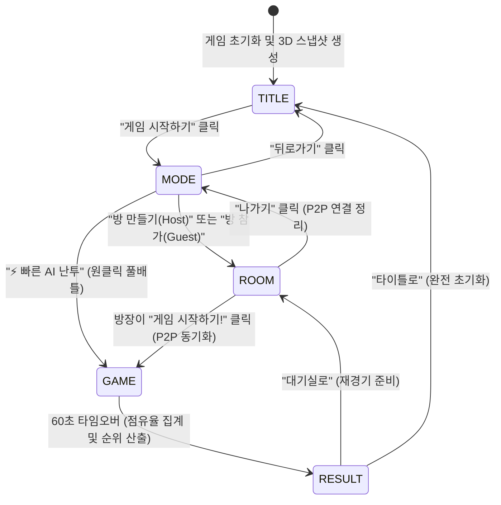

# 🎨 쁘니 페인터즈 (Ppeuni Painters)
> **3D 실시간 캐주얼 영역 점유 배틀 (Realtime 3D Turf Battle Game)**  
> 친구들과 함께 3D 경기장을 뛰어다니며 알록달록 바닥을 칠해보세요!


---

## 📖 1. 게임 개요 (Game Overview)

**쁘니 페인터즈(Ppeuni Painters)**는 닌텐도의 스플래툰(Splatoon) 게임 플레이 메커니즘을 캐주얼한 모바일/웹 3D 환경으로 재해석한 **실시간 4인 영역 점유(Turf Battle) 대전 게임**입니다.

귀여운 4명의 쁘니 캐릭터들이 제한 시간 60초 동안 경기장을 자유롭게 누비며 자신의 페인트 롤러와 브러시로 바닥 타일을 칠합니다. 게임 종료 시 가장 많은 영역(타일)을 자신의 색상으로 칠한 플레이어가 우승을 차지합니다.

* **플레이 인원:** 2 ~ 4인 (실시간 P2P 멀티플레이 및 똑똑한 AI 봇 지원)
* **경기 시간:** 60초
* **지원 플랫폼:** 모바일(스마트폰/태블릿 터치 조이스틱) 및 PC(키보드 WASD / 방향키) 완벽 대응
* **특징:** 외부 백엔드 서버 없이 브라우저 간 WebRTC P2P로 직접 통신하는 가벼운 서버리스 구조

---

## 🛠️ 2. 기술 스택 (Tech Stack)

| 분류 | 기술 / 라이브러리 | 설명 |
| :--- | :--- | :--- |
| **코어 언어** | **Vanilla JavaScript (ES6+)** | 외부 프레임워크 종속성 없는 가볍고 빠른 순수 자바스크립트 모듈 |
| **3D 그래픽 엔진** | **Three.js (r128)** | 3D 씬, 지형, 조명, 셰이더 및 `InstancedMesh` 기반 고성능 렌더링 |
| **오프스크린 렌더링** | **WebGLRenderer (Offscreen)** | 3D 인게임 피규어를 백그라운드에서 실시간 스냅샷 캡처하여 UI에 자동 바인딩 |
| **P2P 멀티플레이어** | **PeerJS (WebRTC)** | 별도 게임 서버 없이 4자리 숫자 방 코드로 호스트-게스트 간 초저지연 상태 동기화 |
| **오디오 엔진** | **Web Audio API** | 외부 mp3/wav 파일 로딩 없이 오실레이터로 실시간 합성하는 무용량 사운드 시스템 |
| **UI & 스타일링** | **HTML5 + CSS3 + SVG** | 글래스모피즘(Glassmorphism), SVG 벡터 입체 타이틀, 반응형 플렉스/그리드 레이아웃 |
| **시각 효과** | **Canvas Confetti** | 경기 종료 및 우승 세레머니를 위한 파티클 축하 효과 |
| **타이포그래피** | **Google Fonts** | MZ 감성의 트렌디 폰트 (`Bagel Fat One`, `Do Hyeon`, `Jua`, `Nunito`) |

---

## 🏛️ 3. 프로젝트 아키텍처 및 게임 구조

### 3.1 디렉토리 구조
```
BB_Paint/
├── index.html          # 전체 UI 마크업 (타이틀, 모드선택, 대기실, HUD, 모달, 결과창)
├── style.css           # 반응형 글래스모피즘 디자인 시스템, 애니메이션, 상태별 버튼 스타일
├── app.js              # 메인 게임 엔진, Three.js 파이프라인, P2P 네트워크, AI, 사운드 신디사이저
├── package.json        # 프로젝트 메타데이터 및 로컬 개발용 스크립트
├── README.md           # 프로젝트 종합 기술 문서
└── assets/             # 고화질 2D 캐릭터 일러스트 (투명 배경 PNG)
    ├── player_1.png    # 말랑쁘니 (Red)
    ├── player_2.png    # 강아지쁘니 (Blue)
    ├── player_3.png    # 시크릿쁘니 (Yellow)
    └── player_4.png    # 돼지쁘니 (Pink)
```

### 3.2 게임 내부 상태 머신 (Game State Machine)
게임은 다음과 같이 명확히 분리된 상태 머신을 기반으로 유기적으로 동작합니다.



---

## ✨ 4. 주요 구현 기능 상세

### 4.1 상용 게임급 단계별 화면 분리 (Title ➔ Mode ➔ Room ➔ Game ➔ Result)
* **타이틀 화면:** 생동감 넘치는 구름/태양광/페인트 스플래시 배경과 쁘니 4인방의 2D 오리지널 쇼케이스 일러스트 노출.
* **SVG 벡터 입체 타이틀 로고:** CSS 글자 외곽선 뭉개짐을 원천 방지하기 위해 `paint-order="stroke fill"`과 3D 엠보싱 드롭 섀도 필터를 적용한 선명한 벡터 타이틀 구현.
* **게임방법 모달:** 타이틀 화면 어디서든 상단 `? 게임 방법`을 누르면 최상위 레이어(`z-index: 100`)로 즉시 열람 가능.

### 4.2 WebRTC 기반 서버리스 P2P 멀티플레이어
* **4자리 방 코드 시스템:** 호스트가 방을 생성하면 `TC-XXXX` 형태의 간결한 4자리 코드가 발급되며 원클릭 클립보드 복사 지원.
* **스타 토폴로지(Star Topology):** 호스트가 서버 역할을 겸하여 20Hz 주기 상태 동기화 및 0.33Hz 주기 전체 타일 스냅샷 동기화 브로드캐스트.
* **호스트 권한 제어:**
  * **방장(Host):** 인원수 설정(2~4인), 슬롯별 AI/유저 토글, 게임 시작 권한 보유.
  * **참가원(Guest):** 하단 게임 시작 버튼이 **`⏳ 방장 시작 대기 중...`** 회색조 비활성화 상태(`disabled`)로 자동 전환되며, 하단에 대기 안내 문구가 표시됨.

### 4.3 캐릭터 중복 선택 100% 방지 (Unique Character Allocation)
* 어떤 플레이어(또는 AI)가 캐릭터를 선택하면, 다른 플레이어 및 AI는 해당 캐릭터를 중복으로 가질 수 없습니다.
* 이미 다른 슬롯이 차지한 캐릭터를 클릭하면 서로의 캐릭터를 맞교환(Swap)하고 실시간 브로드캐스트하여 4명의 캐릭터가 항상 고유하게 유지됩니다.

### 4.4 3D 클레이 아트토이 캐릭터 & 오프스크린 스냅샷
* **앞머리 없는 깔끔한 C컬 단발머리:** 앞머리를 완전히 걷어내어 둥글고 매끄러운 찹쌀떡 이마를 시원하게 드러내고, 양옆 뺨을 안쪽으로 감싸는 단발 C컬 볼륨과 목덜미 언더컷 라인으로 귀여운 실루엣을 완성했습니다.
* **미니멀 피규어 디자인:** 머리와 얼굴의 눈, 코, 입, 볼터치를 모두 제거하여 트렌디하고 세련된 찹쌀떡 아트토이 피규어 스타일 완성.
* **오프스크린 스냅샷 연동:** 게임 구동 시 오프스크린 WebGL 렌더러가 3D 캐릭터를 스튜디오 조명 각도로 촬영하여 DataURL을 생성하고, 대기실 선택창(`.picker-item`), 슬롯 카드, 인게임 HUD 뱃지에 자동 주입.

### 4.5 인게임 HUD 컨트롤 & '나가기' 기능
* **상단 HUD 점유율 바 & 타이머:** 실시간 타일 점유 비율과 남은 경기 시간(60초)을 상시 표시.
* **인게임 즉시 나가기 (`#btn-ingame-exit`):** 경기 도중 언제든지 경기를 중단하고 안전하게 타이틀 화면으로 복귀할 수 있는 팝업 확인 모달 연동 나가기 버튼 지원 (P2P 네트워크 자동 정리 및 상대방 AI 자동 전환 처리).

### 4.5 고성능 3D 타일 필드 (`THREE.InstancedMesh`)
* **1 드로우 콜 최적화:** 20×20(총 400개) 타일을 개별 Mesh가 아닌 단 하나의 `InstancedMesh`로 관리하여 모바일 저사양 기기에서도 60 FPS 유지.
* **물리 팝업 애니메이션:** 캐릭터가 지나가며 타일을 칠할 때 해당 타일이 위로 `1.55배` 튀어 올랐다가 자연스럽게 복원되는 쫀득한 탄성 애니메이션 제공.

### 4.6 Web Audio API 무용량 사운드 시스템
* 외부 오디오 파일을 다운로드하지 않고, 브라우저 오디오 컨텍스트의 `OscillatorNode`와 `GainNode`를 결합하여 실시간 주파수 변조 사운드 생성.
  * **타일 페인트 팝:** 캐릭터별로 다른 피치의 상큼한 버블 사운드 (`playPaintPop`)
  * **카운트다운 비프음:** 삼각파 기반 삑 비프음 (`playBeep`)
  * **승리 팡파레:** 4개 음계(C-E-G-C) 아르페지오 팡파레 (`playFanfare`)

### 4.7 경기 결과 본인 전용 스포트라이트 시스템
* 기존 1등만 부각되던 문제를 개편하여 **'내 결과 전용 스포트라이트 카드 (`#my-result-banner`)'** 신설.
  * 우승 여부와 상관없이 본인의 순위(`1위`, `2위`, `3위`, `4위`), 점유율(%), 칠한 타일 개수, 맞춤형 평가 문구를 최상단에 대형 카드로 브리핑.
  * 순위 리스트 내 본인 행에 네온 그린 글로우 테두리와 **`YOU (나)`** 식별 뱃지 부착.

---

## 🎮 5. 게임 규칙 및 조작 가이드

### 5.1 규칙 및 승리 조건
1. 총 60초 동안 경기장 바닥을 칠합니다.
2. 이미 다른 플레이어가 칠해둔 타일 위를 지나가면 내 색상으로 덮어쓸 수 있습니다.
3. 60초 종료 시점에 가장 높은 점유율(%)을 기록한 플레이어가 승리합니다.

### 5.2 조작 방법
| 플랫폼 | 조작 키 / 인터페이스 | 동작 |
| :--- | :--- | :--- |
| **PC 키보드** | `W` `A` `S` `D` 또는 `방향키 (↑ ← ↓ →)` | 상·하·좌·우 8방향 이동 |
| **모바일 / 태블릿**| **화면 좌측 하단 가상 조이스틱** (터치 & 드래그) | 360도 자유 방향 및 이동 속도 제어 |

---

## 🚀 6. 실행 및 배포 방법

본 프로젝트는 순수 프론트엔드 정적 파일(HTML, CSS, JS)로 구성되어 있어 별도의 복잡한 빌드 과정 없이 즉시 실행 및 배포가 가능합니다.

### 6.1 로컬 환경에서 실행하기

> [!NOTE]
> ES 모듈(`import * as THREE`)을 사용하므로 `file:///` 프로토콜 대신 **로컬 웹 서버** 환경에서 구동해야 합니다.

#### 방법 A: Node.js (권장)
```bash
# 1. 저장소 폴더로 이동
cd c:\kukky_Work\Antigravity_PJ\BB_Paint

# 2. 로컬 서버 실행 (포트 3000)
npm start
# 또는
npx serve -l 3000
```
브라우저에서 `http://localhost:3000` 접속

#### 방법 B: Python 내장 서버
```bash
# Python 3.x
python -m http.server 3000
```
브라우저에서 `http://localhost:3000` 접속

#### 방법 C: VS Code Live Server
* VS Code에서 `BB_Paint` 폴더를 열고 `index.html` 우클릭 ➔ **"Open with Live Server"** 선택.

---

### 6.2 프로덕션 웹 호스팅 배포

GitHub Pages, Vercel, Netlify, Cloudflare Pages 등 정적 호스팅 서비스에 원클릭으로 배포할 수 있습니다.

#### Vercel 배포 예시
```bash
# vercel cli 사용 시
npx vercel --prod
```

#### GitHub Pages 배포 예시
1. 저장소의 `main` 브랜치에 코드 푸시
2. GitHub Repository ➔ **Settings** ➔ **Pages** ➔ Source를 `Deploy from a branch` (Branch: `main`, Folder: `/root`) 선택 후 저장

> [!IMPORTANT]
> WebRTC P2P 통신 및 최신 브라우저 보안 정책 상, 공용 네트워크 배포 시 반드시 **HTTPS** 프로토콜 환경에서 서빙되어야 원활한 P2P 접속이 보장됩니다.

---

## 🔧 7. 유지보수 및 향후 개발 로드맵

### 7.1 유지보수 시 유의사항
* **Three.js Mesh와 Geometry 구별:**
  * Geometry의 치수를 변경할 때는 `geom.scale(x, y, z)`를 사용합니다.
  * Mesh 인스턴스의 스케일을 변경할 때는 반드시 `mesh.scale.set(x, y, z)`를 사용해야 런타임 `TypeError`를 방지할 수 있습니다.
* **캐릭터 3D 빌더(`build3DCharacterModel`):**
  * 캐릭터의 외형이나 부속품을 수정할 경우, `app.js` 상단의 `build3DCharacterModel()` 함수만 수정하면 인게임 3D 모델과 오프스크린 스냅샷에 동시에 자동 반영됩니다.
* **방장 권한 UI 동기화:**
  * 대기실 화면이나 슬롯 상태가 변경될 때는 항상 `updateRoomActionButtons()`가 호출되도록 하여 게스트의 게임시작 버튼 비활성화 상태가 풀리지 않도록 유지해야 합니다.

### 7.2 향후 확장 권장 사항 (Roadmap)
1. **TURN 서버(STUN/TURN Relay) 보강:**
   * 현재 무료 PeerJS 클라우드 브로커를 사용 중입니다. NAT 방화벽이 엄격한 모바일 통신망(LTE/5G) 간 원활한 연결을 위해 자체 CoTurn 서버 주소를 `peerConfig`에 추가할 수 있습니다.
2. **다양한 경기장 맵 및 장애물 추가:**
   * 점프대, 잉크 가속 레일, 회전 장애물 등 다양한 3D 오브젝트를 배치할 수 있는 맵 로더 기능.
3. **특수 스킬 / 아이템 시스템:**
   * 잉크 롤러 대형화, 슈퍼 잉크 폭탄 투척 등 일발 역전이 가능한 스킬 메커니즘.
4. **외부 3D 모델 포맷(GLTF/GLB) 로더 지원:**
   * Three.js 프리미티브 방식 외에 Blender 등에서 제작한 정밀 3D 캐릭터 모델과 본(Bone) 애니메이션을 로드할 수 있도록 파이프라인 확장.

---

## 📄 라이선스 (License)
This project is open-source and available under the [MIT License](LICENSE).  
Copyright (c) 2026 Ppeuni Painters Team. All rights reserved.

